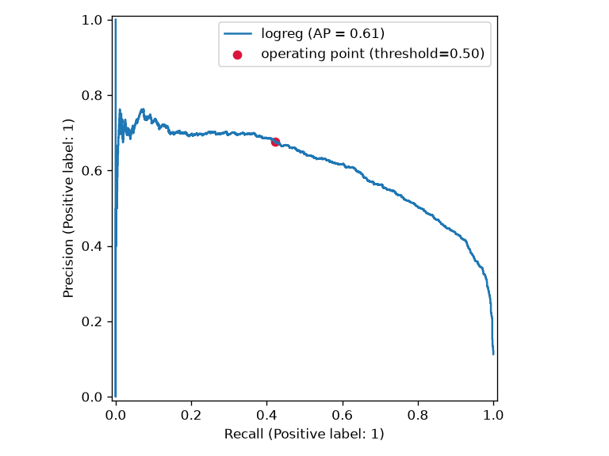
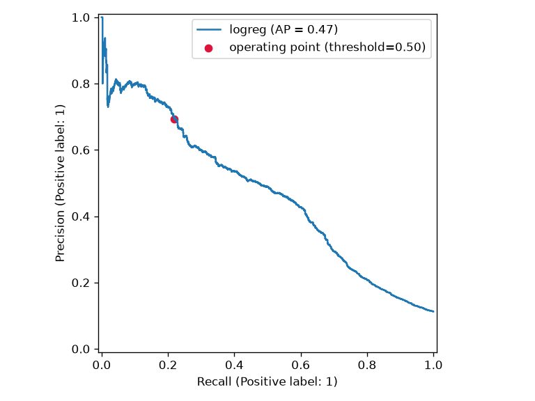
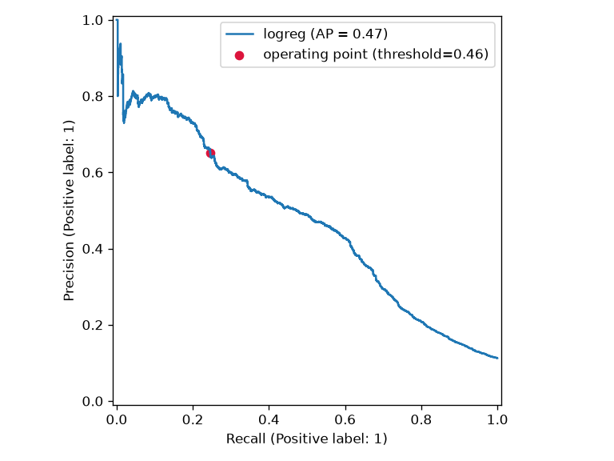
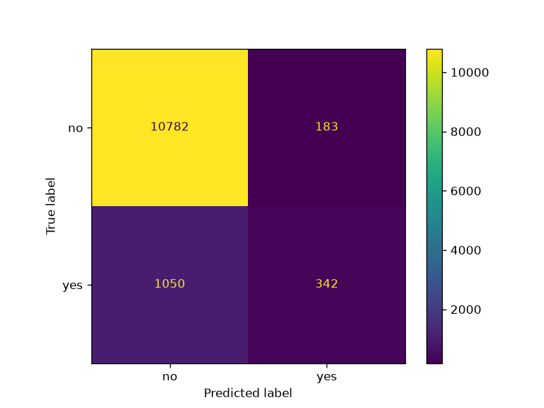

# Bank Marketing — Experiment Report

Propensity modelling for outbound telemarketing: model choice, threshold selection and
leakage control, written up with the formulas behind each number.

**Scope.** Every figure in this report is measured, not estimated. All numbers were read
back from the three MLflow runs in experiment `bank-marketing` and reproduced with the
commands in §12. Figures in this report are copies of the run artifacts under `figures/`.
Unless stated otherwise, every run uses the same stratified split (`seed=42`), so the
comparisons are paired.

---

## 1. Summary

- **Shipped model:** logistic regression on data v2 with a business-constrained threshold,
  $\tau^* = 0.4569$. Test PR-AUC $0.4679$, precision $0.651$, recall $0.246$.
- **The higher-scoring model is not shippable.** `v1-baseline-logreg` scores
  $0.6064$ PR-AUC, and its advantage is entirely the `duration` column, which does not exist
  until the call has ended. The number is unattainable in production, not merely optimistic.
- **Within the deployable feature set the win came from the decision rule, not the model.**
  Both v2 runs share one PR curve and therefore one PR-AUC ($0.4679$). Moving the threshold
  from the library default $0.5$ to $0.4569$ raises recall from $0.219$ to $0.246$ at
  comparable precision: $525$ calls instead of $440$, $1{,}050$ missed subscribers instead of
  $1{,}087$.
- **The threshold is fitted on a validation split, never on test.** Selecting it on test
  would report recall $0.301$ instead of $0.246$ — an inflation of $+0.055$ ($+22\%$
  relative) that does not survive contact with new data. See §5.3.

---

## 2. Data

| | |
|---|---|
| Source | UCI ML Repository id 222, *Bank Marketing* (with social/economic context) |
| File | `bank-additional/bank-additional-full.csv`, semicolon separated |
| sha256 | `74adfc578bf77a7ff4bb1ba4a9f8709d9e3c6907342959c2c8416847e0afb4d8` |
| Rows | $n = 41{,}188$ |
| Positive class | $4{,}640$ subscribers, $\pi = 0.112654$ |
| Target | $y_i \in \{0, 1\}$, $y_i = 1 \iff$ `y == "yes"` |

Two versions are derived from that single file by `data_pipeline.py`, so v1 and v2 differ by
a code change rather than by a second download:

| | v1 (as published) | v2 (cleaned) |
|---|---|---|
| Features | 20 | 19 |
| `duration` | kept | **dropped** (target leakage, §7.1) |
| `pdays` | raw $0\text{–}999$ | replaced by `never_contacted` $\in \{0,1\}$ (§7.2) |
| `unknown` | ordinary one-hot level | real missing value (§7.3) |

### Split

Stratified, on the target, with $\text{seed} = 42$:

| Split | Rows | Positives | Positive rate |
|---|---|---|---|
| Train | 28,831 | 3,248 | 11.27 % |
|  └ of which validation | 5,767 | 650 | 11.27 % |
|  └ of which fit | 23,064 | 2,598 | 11.27 % |
| Test | 12,357 | 1,392 | 11.2649 % |

Splitting is stratified and the threshold is tuned on a **validation split carved out of the
training set** ($20\%$ of train), never on test. For the tuned runs the model is fitted twice:
once on the 23,064 fit rows to choose $\tau$, then refitted on the full 28,831 training rows
and evaluated at the frozen $\tau$.

---

## 3. Model

A linear model in a feature space built from two transforms.

### 3.1 Preprocessing

Standardisation of the numeric columns, with $\mu_j, s_j$ estimated on the fitting fold only:

$$
\tilde{x}_{ij} = \frac{x_{ij} - \mu_j}{s_j}
$$

One-hot encoding of the categorical columns:

$$
\phi_{jc}(x) = \mathbb{1}[x_j = c]
$$

Both live inside one scikit-learn `Pipeline`, so they are refitted per fold and no test
information reaches the transformer. `handle_unknown="ignore"` maps an unseen level to the
all-zero vector instead of raising, and `unknown` in v2 is a genuine `NaN` and therefore gets
its own indicator column rather than being folded into the reference level.

### 3.2 Logistic regression

With $\phi(\mathbf{x})$ the concatenation of the two transforms,

$$
z(\mathbf{x}) = \beta_0 + \boldsymbol\beta^\top \phi(\mathbf{x}),
\qquad
p_\theta(\mathbf{x}) = \sigma\big(z(\mathbf{x})\big) = \frac{1}{1 + e^{-z(\mathbf{x})}}
$$

Equivalently, the model is linear in the log-odds, which is why coefficients stay reviewable:

$$
\log \frac{p_\theta(\mathbf{x})}{1 - p_\theta(\mathbf{x})} = \beta_0 + \boldsymbol\beta^\top \phi(\mathbf{x})
$$

so $\beta_j$ is the additive change in log-odds per one standard deviation of feature $j$
(per one-hot level, for categoricals).

Fitting minimises $L_2$-penalised negative log-likelihood, in scikit-learn's parameterisation
with $\tilde{y}_i = 2y_i - 1 \in \{-1, +1\}$:

$$
\min_{\beta_0, \boldsymbol\beta} \; \frac{1}{2}\lVert \boldsymbol\beta \rVert_2^2
\;+\; C \sum_{i=1}^{n} \log\!\Big(1 + e^{-\tilde{y}_i z(\mathbf{x}_i)}\Big)
$$

`C` is the inverse regularisation strength: $C = 1/\lambda$ for
$\mathcal{L} = \mathrm{NLL} + \tfrac{1}{2\lambda}\lVert\beta\rVert^2$. The sign of the log-odds
weight, $\partial z / \partial \phi_j = \beta_j$, is what a reviewer reads.

### 3.3 Hyperparameters

Identical in all three runs, so any difference between runs is data or decision rule, never
capacity:

| | |
|---|---|
| `C` | 1.0 |
| `solver` | `lbfgs` |
| `max_iter` | 5000 (converged; the only reason for the cap is the `lbfgs` default of 100) |
| `class_weight` | `None` (tested, rejected — §10) |
| `random_state` | 0 |

---

## 4. Metrics

For a threshold $\tau$, write the confusion counts on the test set:

$$
\mathrm{TP}(\tau) = \#\{i : y_i = 1, p_i \ge \tau\},\quad
\mathrm{FP}(\tau) = \#\{i : y_i = 0, p_i \ge \tau\},\quad
\mathrm{FN}(\tau) = \#\{i : y_i = 1, p_i < \tau\}
$$

with the corresponding rates

$$
P(\tau) = \frac{\mathrm{TP}}{\mathrm{TP} + \mathrm{FP}},
\qquad
R(\tau) = \frac{\mathrm{TP}}{\mathrm{TP} + \mathrm{FN}},
\qquad
F_1(\tau) = \frac{2 \, P(\tau) R(\tau)}{P(\tau) + R(\tau)}
$$

**Accuracy is not used as a headline metric.** The positive rate is $11.26\%$, so the constant
predictor $\hat{y} \equiv 0$ already achieves

$$
1 - \pi = 0.8874
$$

and every model here scores within $2.5$ points of that. Accuracy cannot separate a useful
model from a useless one on this problem, so it is reported for completeness only.

### 4.1 Ranking metrics

ROC-AUC is the probability that a random positive outranks a random negative
(Mann–Whitney form), and is insensitive to the class balance:

$$
\mathrm{AUC}_{\mathrm{ROC}} = \int_0^1 \mathrm{TPR} \, d(\mathrm{FPR})
= \frac{1}{n_+ n_-} \sum_{i: y_i = 1} \sum_{j: y_j = 0}
\Big[ \mathbb{1}(p_i > p_j) + \tfrac{1}{2}\mathbb{1}(p_i = p_j) \Big]
$$

PR-AUC is the area under the precision–recall curve, computed as average precision over the
distinct thresholds $\tau_1 > \tau_2 > \dots > \tau_K$ with $R_0 = 0$:

$$
\mathrm{AP} = \sum_{k=1}^{K} \big( R_k - R_{k-1} \big) \, P_k
$$

For a random ranker, precision at any achievable recall is $\pi$, so the trivial baseline is

$$
\mathrm{AP}_{\text{random}} = \pi = 0.1127
$$

The shipped model's $0.4679$ is therefore about $4.2\times$ the baseline on a metric that is
calibrated to how hard the problem is — which ROC-AUC, whose trivial baseline is $0.5$, is not.

### 4.2 The metric we optimise

Optimising $\mathrm{AP}$ alone leaves the actual decision unspecified, and the decision is
what the bank acts on. We therefore report the threshold-free quantity

$$
R_{\ge p^*}(s) = \max\big\{ R(\tau) \;:\; P(\tau) \ge p^* \big\}
$$

that is: the highest recall available anywhere on the curve while holding precision at or
above $p^*$ — here $p^* = 0.60$. In business terms, holding precision at $0.60$ caps the share
of calls spent on customers who will not subscribe at $40\%$ (the "do not harass people" side
of the cost) and inside that budget we reach as many future subscribers as possible.

Both quantities are reported because they answer different questions: $\mathrm{AP}$ measures
ranking quality, $R_{\ge p^*}$ measures the attainable operating point under a cost
constraint.

---

## 5. Threshold selection

### 5.1 The decision rule

The model outputs an estimated probability; the service acts on

$$
\hat{y}(\mathbf{x}) = \mathbb{1}\big[\, p_\theta(\mathbf{x}) \ge \tau \,\big]
$$

$\tau$ is a **deployment parameter, not a property of the model**, which is exactly why two of
the three runs share one model and differ only in $\tau$.

### 5.2 Selection under a precision constraint

The threshold is chosen on the validation split, as the point of the validation
precision–recall curve that maximises recall subject to the precision floor:

$$
\tau^* = \tau_{i^*} ,\qquad
i^* = \arg\max_{i \,:\, P_i^{\mathrm{val}} \ge p^*} R_i^{\mathrm{val}} ,
\qquad p^* = 0.60
$$

Scanning recall instead of taking the smallest admissible threshold matters because the
empirical precision curve is not monotone. Applied to the production run this returns
$\tau^* = 0.4569$, at which the test set gives $P = 0.651$ and $R = 0.246$.

### 5.3 Why not select on the test set

Because the maximum of a noisy estimate over many candidates is biased upward:

$$
\mathbb{E}\Big[\max_{\tau \in \mathcal{T}} \hat{R}_{\mathrm{test}}(\tau)\Big]
\;\ge\; \max_{\tau \in \mathcal{T}} \mathbb{E}\big[\hat{R}_{\mathrm{test}}(\tau)\big]
\;\ge\; R_{\mathrm{true}}(\tau^\star)
$$

and $|\mathcal{T}|$ here is on the order of $10^4$ distinct probabilities ($12{,}190$ distinct
values on 12,357 test rows), which is ample opportunity to find a flattering point. Measured
on this pipeline, selecting $\tau$ directly on test yields

| Selection set | $\tau$ | Test precision | Test recall | Test $F_1$ | Calls | Missed |
|---|---|---|---|---|---|---|
| Validation (reported) | 0.457 | 0.651 | **0.246** | 0.357 | 525 | 1,050 |
| Test (rejected) | 0.410 | 0.600 | *0.301* | 0.401 | 698 | 973 |

The second row is the number you get by overfitting the decision rule: $+0.055$ recall, free
of charge, and reproducible only on the data it was chosen on. The pipeline reports the first
row and the code has no path that fits on test.

### 5.4 Where the precision floor comes from

A precision floor is a proxy for a cost ratio. Let a call to a non-subscriber cost $c_{\mathrm{FP}}$
(wasted agent time, nuisance) and a missed subscriber cost $c_{\mathrm{FN}}$ (a lost deposit).
For a customer with $p = \Pr(y = 1 \mid \mathbf{x})$, the expected cost of acting versus not
acting is

$$
\mathbb{E}[C \mid \text{call}] = c_{\mathrm{FP}} \, (1 - p),
\qquad
\mathbb{E}[C \mid \text{no call}] = c_{\mathrm{FN}} \, p
$$

and the two are equal at

$$
p = \tau^{\star}_{\text{cost}} = \frac{c_{\mathrm{FP}}}{c_{\mathrm{FP}} + c_{\mathrm{FN}}}
$$

Three readings of that identity:

- **Equal costs give the library default for free:** $c_{\mathrm{FP}} = c_{\mathrm{FN}}$ implies
  $\tau^\star = 0.5$. Leaving the threshold at $0.5$ is not a neutral choice — it is the claim
  that a wasted call and a lost subscriber cost the same.
- **The shipped threshold states the ratio.** $\tau = 0.4569$ implies
  $\dfrac{c_{\mathrm{FP}}}{c_{\mathrm{FN}}} = \dfrac{0.4569}{0.5431} \approx 0.84$, i.e. a missed
  subscriber is worth roughly $1.19\times$ a wasted call.
- **The floor is the distribution-free version of the same statement.** For a calibrated model,
  $P(\tau) \approx \mathbb{E}[p \mid p \ge \tau] \ge \tau$, so a precision floor is in the same
  currency as a cost ratio. We implement the floor rather than the ratio because the bank's
  $c_{\mathrm{FP}}/c_{\mathrm{FN}}$ was not supplied; the floor is the input the service
  actually exposes, as `DECISION_THRESHOLD`.

---

## 6. Results

All three runs, test set (12,357 rows, 1,392 positives). $\mathrm{R@}P_{\ge 0.6}$ is the
threshold-free quantity from §4.2, identical for two runs because they share a model.

| | `v1-baseline-logreg` | `v2-logreg-default-threshold` | `v2-logreg-tuned-threshold` |
|---|---|---|---|
| Data version | v1 | v2 | v2 |
| Features | 20 | 19 | 19 |
| Threshold $\tau$ | 0.5 (fixed) | 0.5 (fixed) | **0.4569** (validation) |
| Deployable | no | yes | **yes (shipped)** |
| PR-AUC | **0.6064** | 0.4679 | 0.4679 |
| ROC-AUC | 0.9383 | 0.8035 | 0.8035 |
| Accuracy | 0.9120 | 0.9011 | 0.9002 |
| Precision | 0.6751 | 0.6932 | 0.6514 |
| Recall | 0.4224 | 0.2191 | 0.2457 |
| $F_1$ | 0.5197 | 0.3330 | 0.3568 |
| Calls made | 871 | 440 | 525 |
| Missed subscribers | 804 | 1,087 | 1,050 |
| $\mathrm{R@}P_{\ge 0.5}$ | 0.8068 | 0.4727 | 0.4727 |
| $\mathrm{R@}P_{\ge 0.6}$ | 0.6372 | 0.3010 | 0.3010 |
| $\mathrm{R@}P_{\ge 0.7}$ | 0.3369 | 0.2191 | 0.2191 |

MLflow run ids:

| Run | Run id |
|---|---|
| `v1-baseline-logreg` | `ecd4b08c82554c7ab2ec5f3382db9f45` |
| `v2-logreg-default-threshold` | `6879ad20c8894ddcadaee8329b911d13` |
| `v2-logreg-tuned-threshold` | `e209c4188caf4b8f8c9c84639e874d38` |

### 6.1 Reading the table

The v1 column wins on every metric and is still the wrong model to ship (§7.1). Among the two
deployable rows, precision, recall and $F_1$ differ while PR-AUC and ROC-AUC are identical to
four decimals — the signature of one model evaluated at two operating points rather than two
models. The tuned threshold buys, at a fixed precision budget:

$$
\Delta \mathrm{calls} = 525 - 440 = 85,
\qquad
\Delta \mathrm{TP} = 342 - 305 = 37,
\qquad
\text{recall } 0.2191 \to 0.2457
$$

so the marginal calls convert at $37/85 = 43.5\%$. That is well above the $11.27\%$ base rate
but below the $65.1\%$ precision of the calls already being made, which is the expected shape:
lowering the threshold descends into the part of the ranking where the model is less certain,
and the $0.60$ floor is the thing that stops that descent. The count of missed subscribers falls
from $1{,}087$ to $1{,}050$, i.e. by the same $37$.

### 6.2 Figures

PR curve, v1 baseline (leakage — note $\mathrm{AP} = 0.61$):



PR curve, v2 with the default threshold:



PR curve, v2 with the tuned threshold (shipped):



Confusion matrix, v2 tuned threshold at $\tau = 0.4569$:



---

## 7. Leakage and data versioning

### 7.1 `duration` — the reason v1 is not shippable

Call duration is known only once the call is over, so it cannot be an input at scoring time.
The dataset authors state this directly in `bank-additional-names.txt`: the attribute *"highly
affects the output target ... should only be included for benchmark purposes and should be
discarded if the intention is to have a realistic predictive model."* The effect is large:

| | Mean `duration` |
|---|---|
| Subscribers ($y=1$) | 553.2 s |
| Non-subscribers ($y=0$) | 220.8 s |

so the column separates the classes almost by itself, and it also inverts causality: a long
call is a *consequence* of a customer who engaged, not a cause available beforehand.

The formal problem is a support mismatch. Let $s(\mathbf{x}, d)$ be a scoring function that
consumes duration. Offline we can estimate

$$
\hat{R}_{v1} = \frac{1}{n_{\mathrm{test}}}\sum_i \ell\big(y_i, s(\mathbf{x}_i, d_i)\big)
= 0.6064
$$

but the deployed service can only compute $s(\mathbf{x}, \tilde{d})$ for some imputation
$\tilde{d}$ chosen without information, because at scoring time duration is undefined. The
offline estimate is therefore not a sample estimate of any deployable quantity:

$$
\hat{R}_{v1} \;\not\to\; \mathbb{E}\big[\ell\big(y, s(\mathbf{x}, \tilde{d})\big)\big]
$$

The gap it creates is measured in this project: dropping the column costs
$0.6064 - 0.4679 = 0.1385$ PR-AUC. That $0.1385$ is not performance that was given up — it is
performance that was never available. Shipping the v1 model would mean being unable to score
any live customer at all, and the size of the offline-to-online gap is exactly the failure
mode this project exists to catch.

### 7.2 `pdays` — a sentinel encoded as a quantity

`pdays` uses $999$ for "never contacted before", and $96.32\%$ of rows carry that value. Fed to
a scaler as a number, the column is dominated by a spike at $999$ that means "missing", not
"contacted $999$ days ago". v2 keeps the informative binary part and drops the quantity:

$$
\texttt{never\_contacted} = \mathbb{1}[\texttt{pdays} = 999],
\qquad \texttt{pdays} \text{ dropped}
$$

### 7.3 `unknown` — a placeholder encoded as a category

Six columns use the literal string `unknown` for "customer did not disclose":

| Column | `unknown` rows | Share |
|---|---|---|
| `default` | 8,597 | 20.9 % |
| `education` | 1,731 | 4.2 % |
| `housing` | 990 | 2.4 % |
| `loan` | 990 | 2.4 % |
| `job` | 330 | 0.8 % |
| `marital` | 80 | 0.2 % |

v1 one-hot encodes those as ordinary levels, which tells the model "non-disclosure" is a
category like any other. v2 maps them to `NaN`, which `OneHotEncoder` encodes as a dedicated
indicator column while leaving the disclosed levels untouched.

---

## 8. Threshold sensitivity

The constraint is a business input, so the pipeline was swept over it. In every row the
threshold is selected on validation and then evaluated on test — the sweep is over the
*constraint*, not over the threshold, which is what keeps the table honest:

| Precision constraint $p^*$ | Selected $\tau$ | Test precision | Test recall | Test $F_1$ | Calls | Missed |
|---|---|---|---|---|---|---|
| $\ge 0.70$ | 0.600 | 0.748 | 0.170 | 0.277 | 317 | 1,155 |
| $\ge 0.60$ (shipped) | 0.457 | 0.651 | 0.246 | 0.357 | 525 | 1,050 |
| $\ge 0.50$ | 0.356 | 0.545 | 0.376 | 0.445 | 959 | 869 |
| default | 0.500 | 0.693 | 0.219 | 0.333 | 440 | 1,087 |

The table is monotone in the expected direction: relaxing the precision floor buys recall and
costs calls. Two features are worth noting. First, the selected $\tau$ is not monotone in the
constraint ($0.457$ for $p^* = 0.60$ versus $0.356$ for $p^* = 0.50$), because precision is a
non-monotone function of the threshold; this is why the rule in §5.2 scans the curve instead of
inverting $P(\tau) = p^*$. Second, the default $0.5$ scores *better* on precision than the
$p^* = 0.50$ row — the default is not a no-op, it is a particular point on the same curve.

It also shows the shape of the trade-off the bank is buying: moving from $p^* = 0.70$ to
$p^* = 0.50$ adds $642$ calls and reaches $287$ more subscribers, so the marginal calls
convert at roughly $45\%$ — well below the $60$–$70\%$ precision of the calls already being
made, which is the quantitative statement of "we are past the point where more calls are
worth it".

---

## 9. Ablations that did not help

Recorded so nobody re-runs them:

| Change | PR-AUC | Verdict |
|---|---|---|
| v2, `class_weight="balanced"` | 0.461 | rejected: below 0.468, and worse recall at the operating point |
| v2, `C` grid over $\{0.01, 0.1, 1, 10\}$ | best `C=1` | rejected: the default was already optimal |
| v2 + feature engineering (cyclical month, age/campaign bins, macro interactions) | 0.466 | rejected: no gain |
| v2 + `HistGradientBoostingClassifier` | 0.493 | rejected in favour of the linear model |

The last row is the useful one: a gradient-boosted model buys about $+0.03$ PR-AUC
($0.4679 \to 0.493$) and costs the interpretability that makes coefficients reviewable. Since
that gain does not change any decision the bank acts on — the threshold is still set by the
precision floor, not by the ranking — the linear model was kept. The ceiling available from
modelling is roughly $0.47$; the available gains were in the data version (§7) and the decision
rule (§5).

---

## 10. Reproducibility

```bash
python ml/train.py --run baseline        # v1, expected PR-AUC 0.6064
python ml/train.py --run v2_default      # v2, threshold 0.5, expected PR-AUC 0.4679
python ml/train.py --run production      # v2, tuned threshold, expected PR-AUC 0.4679
mlflow ui --backend-store-uri sqlite:///mlflow_final.db --port 5002
```

Runs are deterministic given $\text{seed} = 42$: the split, the model's `random_state` and the
threshold rule are all fixed, and the numbers above reproduce exactly.

Port note: `--port 5002` is deliberate. Port 5000 is occupied on this machine by an older
MLflow server from another checkout and by the macOS AirPlay Receiver, which binds `*:5000`
and cannot be displaced reliably; the UI therefore runs on 5002.

### Provenance

Every run logs what produced it, so "which dataset made this model" is answerable without
memory:

| Step | Identifier | Logged as |
|---|---|---|
| Data content | `74adfc578bf77a7ff4bb1ba4a9f8709d9e3c6907342959c2c8416847e0afb4d8` | `dataset_sha256` tag |
| Data pointer | md5 from `data.dvc` | `dvc_dataset_hash` tag |
| Code | git SHA | `git_sha` tag |
| Code (copy) | `data_pipeline.py`, `train.py` | artifacts under `code/` |
| Config | run config | `run_config.json` artifact |
| Metrics | all of the above | `metrics.json` artifact, `plots/` |

**Known gap:** the three runs currently in the tracking store carry `git_sha = unknown`,
because they were produced outside a git working tree. The tags exist and are populated
automatically the moment `ml/train.py` runs inside a checkout; until then the data identity
(sha256) is recorded but the code identity is not. The `README_data.md` table mapping data
version to commit hash is still `TODO` for the same reason.

---

## Appendix A. Metric identities used above

**Why the PR-AUC baseline is $\pi$.** If $s$ is independent of $y$, then at any threshold the
expected precision is $\Pr(y = 1 \mid s \ge \tau) = \Pr(y=1) = \pi$, independent of $\tau$, so
the expected precision–recall curve is the horizontal line $P = \pi$ and its area is $\pi$.
This is why PR-AUC must be read relative to $\pi$ and ROC-AUC relative to $0.5$.

**AP as an integral.** The finite-sum definition in §4.1 is the right-Riemann estimator of

$$
\mathrm{AP} = \int_0^1 P(\tau) \, dR(\tau)
$$

and the two agree exactly for the step function produced by a finite sample.

**Threshold-free recall.** $R_{\ge p^*}$ is the value of the PR curve at precision $p^*$,
i.e. the sup over the curve's feasible region, which is why it needs no threshold and can be
compared across runs whose thresholds differ.

**Effective number of candidates.** The selection bias in §5.3 scales with the number of
distinct scores the rule can pick from. On this test split that is $12{,}190$ distinct
probabilities out of $12{,}357$ rows, i.e. the rule has essentially one candidate per row and
can pick the single most favourable one — the worst case for the bias.
